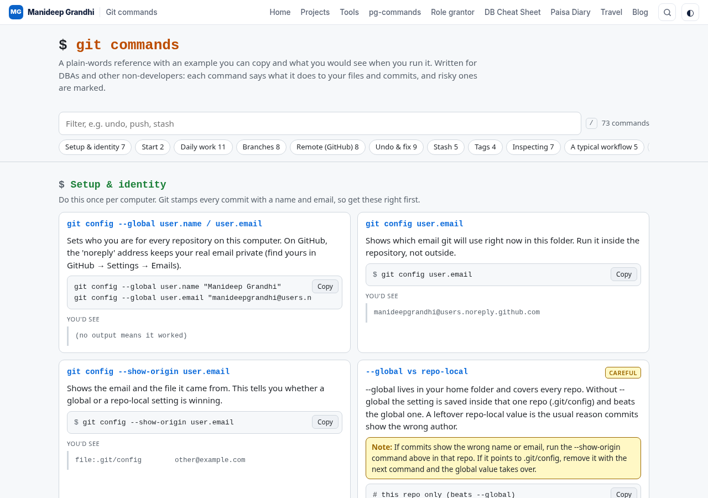

# git commands

**Live:** https://manideepgrandhi.github.io/git-commands/

A small, plain-language reference for the git and `gh` commands used day to day. Written for DBAs and other non-developers: each command has a one-line explanation, an example you can copy, and what you would see when you run it. Risky commands (`reset --hard`, `push --force-with-lease`, amending pushed commits) carry a warning badge.

## What is on the page

73 commands in 11 groups, with a filter box (press `/` to jump to it) and group chips at the top:

| Group | Covers |
|---|---|
| Setup & identity | `git config` name and email (including the GitHub noreply address), `--global` vs repo-local and `--show-origin`, default branch, `pull.rebase` |
| Start | `clone`, `init` |
| Daily work | `status`, `add`, `commit`, `diff`, `log`, `mv`/`rm`, `.gitignore` |
| Branches | `branch`, `switch`, `merge`, merge conflicts, `rebase`, `cherry-pick` |
| Remote (GitHub) | `remote`, `fetch`, `pull`, `push`, `push -u`, deleting a remote branch |
| Undo & fix | `restore`, `commit --amend`, `--amend --reset-author`, `reset --soft/--hard`, `revert`, `push --force-with-lease`, `reflog` |
| Stash | `stash`, `push -u -m`, `list`, `pop`, `drop` |
| Tags | `tag -a`, list, push, delete |
| Inspecting | `log --graph`, `show`, `blame`, `log -S`, filtering, `diff` between branches |
| A typical workflow | branch, commit, push, pull request, merge, in five steps |
| gh CLI basics | `auth`, `repo clone/create`, `pr create/list/checkout/merge` |

## How it is built

One self-contained `index.html`: no build step, no CDNs, no trackers, no network requests from the page. It works offline once loaded. The commands live in the `GROUPS` array near the bottom of the file; add a command by adding one object (`c` title, `d` explanation, `ex` example, `out` output, optional `kind` of `care` or `danger` and a `w` warning).

The example outputs were produced by running the commands in a scratch repository with git 2.47. Hashes and dates were left as they came out; yours will differ. The `gh` examples are illustrative (`gh auth status` was run for real; the pull-request commands were not run against a repository for this page).

### Theme and shared bar

Like the other sites, the page carries an inlined copy of the shared header bar, footer, theme toggle and cross-site search between `<!--mg:head inline-->` / `<!--mg:body inline-->` markers. Do not edit inside the markers. Edit `assets/` in manideepgrandhi.github.io and run `scripts/sync-mg-shared.py` there. The light and dark colours are the CSS variables at the top of the page's `<style>` block.

## Hosting

GitHub Pages, branch `main`, folder `/`. There is no service worker or manifest (the sibling reference pages don't use one either).

## License

MIT, see [LICENSE](LICENSE).
